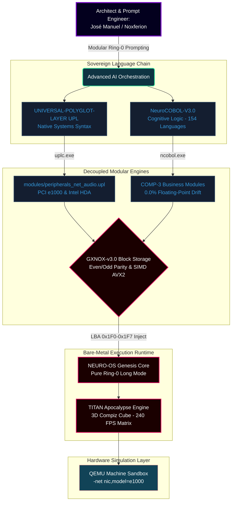

# 👑 NOXFERION // CYBERENIGMA SIV SYSTEM ARCHITECT

<div align="center">
  <code>👑 AUTHORITY SEAL: 0x4A4D4D43 (*JMMC*) | RING-0 ENGINE SIGNATURE: 0x4359454E</code>
  <br><br>
  
  ### 🌌 NEURO-OS GENESIS: THE COGNITIVE BARE-METAL MATRIX
  **100% Co-Diseño Neuronal Extremo · x86_64 Long Mode · Zero Host Runtime Dependencies**
  <br>
  <i>"Ship fast. Learn faster. Dissect silicon. Humanize the machine."</i>
</div>

---

## 🔮 Core Architecture / Arquitectura de la Matriz

Unified systems development matrix built from scratch to establish unmitigated control over the silicon interface. / *Ecosistema y cadenas de herramientas concebidas arquitectónicamente y orquestadas mediante prompting modular de bajo nivel.*



---

## 🛠️ Infrastructure Specification / Ficha Técnica del Ecosistema

| System Layer / Capa | Technology Stack / Base | License Type / Licencia | Silicon Status / Estado | Metadata / Identificadores |
| :--- | :--- | :--- | :--- | :--- |
| **Microkernel Core** | C99 + Assembly x86_64 | Propietaria / Closed | 🟢 Booting & Operative | Pure Ring-0 (4-Level PML4) |
| **UPL+ Toolchain** | 7-Stage Pratt Parser | Private / Privada | 🟢 100% Tests Passed | 64KB Rigid Arena Allocators |
| **NeuroCOBOL-V3.0** | Cognitive Logic Compiler | Registered / Registrada | 🟢 154 Langs Active | Safe Creative ID: 2609217054592 |
| **Storage Engine** | GXNOX-v3.0 Micro-FS | Propietaria / Closed | 🟢 sub-20 µs Self-Healing | Safe Creative ID: 2610197364465 |
| **Visual Transport**| TITAN Apocalypse Engine| Commercial Protection | 🟢 240+ FPS Stable Matrix| DVTRGA-30 / Linear Framebuffer|

---

## 🪐 Advanced Visual Interfaces / Entornos Gráficos en Vivo

Hybrid acceleration rendered directly over the Linear Framebuffer (LFB) with no desktop environment overhead:

*   **1. Sovereign Stellar Desktop (Flat Workspace):** Interface based on `NEURO-KHTML UPL` (*Hover Glow KDE Breeze*) running on native silicon without X11/Wayland abstractions.
*   **2. Compiz Cube 3D Matrix (Interactive Workspace):** Real-time telemetry, isolated virtual environments, and system shell slots mapped onto the faces of a fully hardware-accelerated 3D cube.

---

## 📡 Live System Telemetry / Recibo de Ejecución Modular

```text
=======================================================================
   NEURO-OS GENESIS // INTEGRACIÓN GLOBAL DE LA MATRIZ SOBERANA
   GLOBAL ECOSYSTEM TELEMETRY RELEASES v3.0 // ACTIVE INTERFACE
   SELLO DE AUTORIDAD: 0x4A4D4D43 (*JMMC* - José Manuel Moreno Cano)
=======================================================================
[UPL TOOLCHAIN]  Compiling external modules with uplc.exe...... [OK]
[NEURO-COBOL]    Mapping transactional cognitive business logic. [OK]
[GXNOX STORAGE]  Synchronizing LBA sectors on neuro_disk_gxnox.. [OK]
[PCI SCANNER]    Scanning Gigabit Intel e1000 Adapter on Ring-0... 
                 -> ONLINE (Virtual Network IP: 10.0.2.15)
[ABI DISPATCH]   Loading authentic Multi-OS packages into ATA disk...
                 -> Signature Detected: 0x5A4D (MZ - Windows PE64)
                 -> Execution Slot 3 Active // CPU Return RAX = 0x42
=======================================================================
[SYSTEM READY] Matrix fully coordinated and operating on native silicon.
=======================================================================
```

---

## 🏛️ Legal & Co-Design Declaration / Marco Técnico y Legal

* **EN:** **Neuro-Architect Paradigm:** This full-stack ecosystem represents a shift in systems development. The memory maps, low-level architecture designs, PCI layout configurations, and linguistic syntaxes are structurally conceptualized by me and implemented through advanced AI orchestrations. Software components, dual-bank parity persistence algorithms, and compilers are protected under strict international intellectual property registrations.
* **ES:** **Paradigma de Co-Diseño Neuronal:** Todo este ecosistema representa una redefinición en el desarrollo de sistemas. Los mapas de memoria, el diseño arquitectónico de bajo nivel, la configuración de registros PCI y las sintaxis lingüísticas han sido concebidos por mí y ejecutados mediante orquestación avanzada de IA. Las herramientas, algoritmos de paridad y compiladores están protegidos bajo registros estrictos de propiedad intelectual.

<div align="center">
  <code>[ HOST RUNTIME TERMINATED // exit 0 ]</code>
</div>
