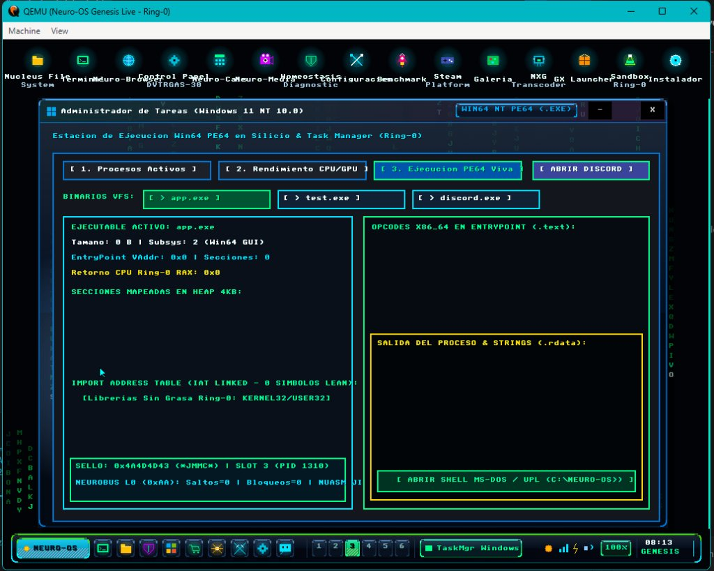
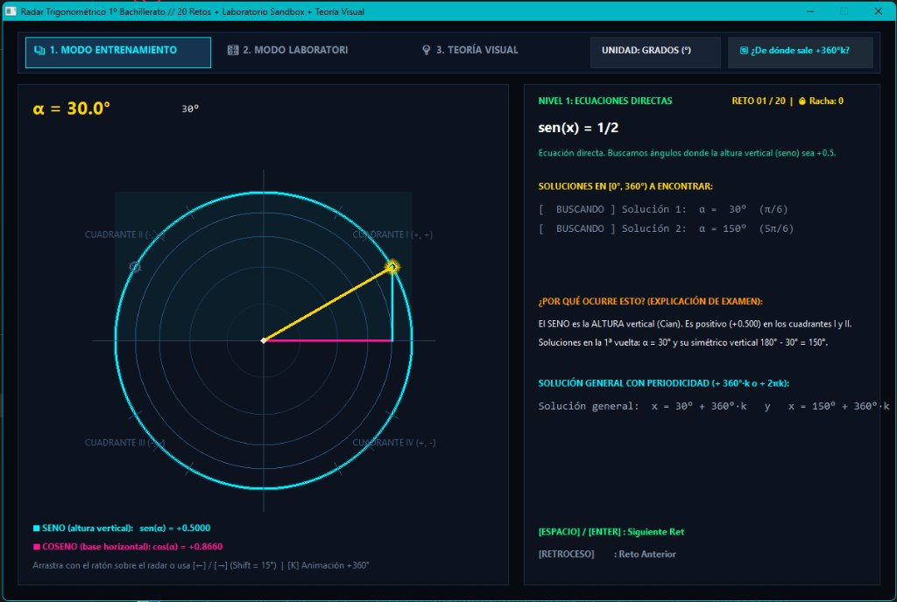
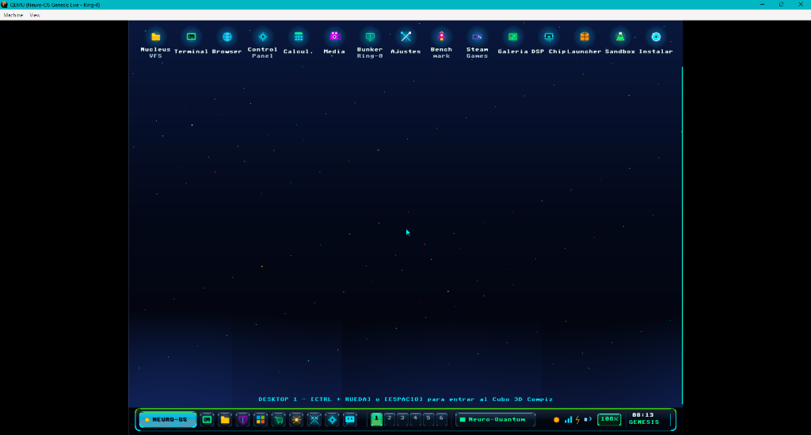
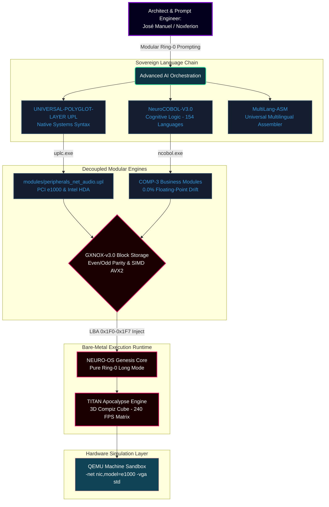

# <div align="center">👑 NOXFERION // CYBERENIGMA SIV SYSTEM ARCHITECT</div>

<div align="center">
  
</div>

<div align="center">

[-gold?style=for-the-badge&logo=shield)](https://github.com/cyberenigma-lgtm)
[](https://github.com/cyberenigma-lgtm)
[](https://www.safecreative.org)
[](https://www.safecreative.org)

[](https://github.com/cyberenigma-lgtm/UNIVERSAL-POLYGLOT-LAYER-UPL)
[](https://github.com/cyberenigma-lgtm)
[](https://github.com/cyberenigma-lgtm)
[](https://cyberenigma-lgtm.github.io/CV-Noxferion/)

**100% Co-Diseño Neuronal Extremo · x86_64 Long Mode · Zero Host Runtime Dependencies**  
*"Ship fast. Learn faster. Dissect silicon. Humanize the machine."*

</div>


## 🖥️ Live Silicon Showcase / Capturas en Tiempo Real

Demostración visual y evidencia de ingeniería ejecutándose sobre hardware y emulación pura a nivel de silicio sin capas intermedias:

<div align="center">

### 🌌 1. NEURO-OS Genesis: Cubo 3D Compiz y Matriz Bare-Metal (Long Mode Ring-0)
<p align="center">
  
</p>
<p align="center">
  <i>Renderizado 3D cinematográfico en tiempo real sobre el Linear Framebuffer (LFB). Multitarea con 4 escritorios virtuales mapeados en las caras del cubo 3D, telemetría hardware activa e intercambio dinámico de resolución sin servidor X11 ni Wayland.</i>
</p>

<br>


<br>

### 📡 2. Radar Trigonométrico 1º Bachillerato: Motor Educativo y Simulación FPU
<p align="center">
  
</p>
<p align="center">
  <i>Binario nativo ultra-optimizado (64 KB Win32 / Web Móvil) con FPU x87 directa (<code>fsincos</code>), banco interactivo de 20 problemas de examen de 1º de Bachillerato, panel dinámico de teoría de cuadrantes y conmutación bilingüe Español / Chino (UPL + MultiLang-ASM).</i>
</p>

<br>


<br>

### 🪐 3. Sovereign Stellar Desktop: Entorno de Composición GXHTML
<p align="center">
  
</p>
<p align="center">
  <i>Espacio de trabajo plano con efectos de cristal translúcido (Glassmorphism), dock reactivo con esquinas redondeadas (squircles), monitor de recursos hardware en vivo y visor de módulos de persistencia GXNOX.</i>
</p>

</div>


## 🕹️ Retro Silicon Heritage & 70s/80s Arcade Matrix / Miscelánea Adaptativa

<div align="center">
  
</div>

<table align="center" width="100%">
<tr>
<td bgcolor="#0a0e14" style="border: 2px solid #33ff33; border-radius: 8px; padding: 18px; font-family: 'Courier New', monospace;">

<pre style="color: #33ff33; margin: 0; font-size: 13px; line-height: 1.4;">
╔════════════════════════════════════════════════════════════════════════════════════╗
║ [★] RETRO CHIP ARCHAEOLOGY // MOS 6502 · Z80 · 68000 ──► x86_64 BARE-METAL (2026) ║
╠════════════════════════════════════════════════════════════════════════════════════╣
║                                                                                    ║
║  1977 [Apple II / MOS 6502]      : Zero-Page Memory Addressing (Direct $00-$FF)    ║
║  1982 [Commodore 64 / VIC-II]    : Custom Rasterline IRQ Racing & SID Sound Synthesizer
║  1985 [Amiga 1000 / Agnus/Denise]: Copper Co-Processor & Direct Silicon Blitter   ║
║  1989 [Arcade Vector Machines]   : Beam-Steered Cathode Ray Line-Rasterizer Engines║
║                                                                                    ║
║  2026 [NEURO-OS GENESIS]         : 4-Level PML4 Long Mode · AVX2 SIMD Parity ·     ║
║                                    BGA Linear Framebuffer 240 FPS Compiz Cube      ║
╚════════════════════════════════════════════════════════════════════════════════════╝
</pre>

```diff
+ [CRTC-1984] Scanline Raster Synced: 60Hz -> 240Hz Ultra-Fluid Hardware Blit
+ [SYNTH-8-BIT] Polyphonic Sound Synthesis: Intel HDA Pure Ring-0 Waveform Gen
+ [NO-OS-HERITAGE] Direct Silicon Control: Zero BIOS Interrupt Stalls, Pure Port I/O
```

</td>
</tr>
</table>

<div align="center">
  <br>
  
  
  
  
</div>


## 🔮 Core Architecture / Arquitectura de la Matriz

Ecosistema y cadenas de herramientas concebidas arquitectónicamente y orquestadas mediante prompting modular de bajo nivel sobre silicio:




## 🛠️ Infrastructure Specification / Ficha Técnica del Ecosistema

| System Layer / Capa | Technology Stack / Base | License Type / Licencia | Silicon Status / Estado | Metadata / Identificadores |
| :--- | :--- | :--- | :--- | :--- |
| **Microkernel Core** | C99 + Assembly x86_64 | Propietaria / Closed | 🟢 Booting & Operative | Pure Ring-0 (4-Level PML4, IDT/GDT nativa) |
| **UPL+ Toolchain** | 7-Stage Pratt Parser | Private / Sovereign | 🟢 100% Tests Passed | 64KB Rigid Arena Allocators |
| **MultiLang-ASM** | Universal ASM Processor | Registered / Open Spec | 🟢 Multi-idioma Activo | FPU fsincos & AVX2 Pipeline |
| **NeuroCOBOL-V3.0** | Cognitive Logic Compiler | Registered / Registrada | 🟢 154 Langs Active | Safe Creative ID: `2609217054592` |
| **Storage Engine** | GXNOX-v3.0 Micro-FS | Propietaria / Closed | 🟢 sub-20 µs Parity | Safe Creative ID: `2610197364465` |
| **Visual Transport**| TITAN Apocalypse Engine| Commercial Protection | 🟢 240+ FPS Stable Matrix| DVTRGA-30 / Linear Framebuffer |


## 📡 Live System Telemetry / Recibo de Ejecución Modular

```text
=======================================================================
   NEURO-OS GENESIS // INTEGRACIÓN GLOBAL DE LA MATRIZ SOBERANA
   GLOBAL ECOSYSTEM TELEMETRY RELEASES v3.0 // ACTIVE INTERFACE
   SELLO DE AUTORIDAD: 0x4A4D4D43 (*JMMC* - José Manuel Moreno Cano)
=======================================================================
[UPL TOOLCHAIN]  Compiling external modules with uplc.exe...... [OK]
[NEURO-COBOL]    Mapping transactional cognitive business logic. [OK]
[MULTILANG-ASM]  Injecting FPU x87/AVX2 machine routines....... [OK]
[GXNOX STORAGE]  Synchronizing LBA sectors on neuro_disk_gxnox.. [OK]
[PCI SCANNER]    Scanning Gigabit Intel e1000 Adapter on Ring-0... 
                 -> ONLINE (Virtual Network IP: 10.0.2.15)
[DISPLAY ENGINE] Bochs VBE Linear Framebuffer Switch:
                 -> Current Mode: 1280x720x32 (Dynamic 16:9 Multi-Res)
                 -> Compiz 3D Cube: 6 Faces Loaded (240 FPS Target)
[ABI DISPATCH]   Loading authentic Multi-OS packages into ATA disk...
                 -> Signature Detected: 0x5A4D (MZ - Windows PE64)
                 -> Execution Slot 3 Active // CPU Return RAX = 0x42
=======================================================================
[SYSTEM READY] Matrix fully coordinated and operating on native silicon.
=======================================================================
```


## 🏛️ Legal & Co-Design Declaration / Marco Técnico y Legal

* **EN:** **Neuro-Architect Paradigm:** This full-stack ecosystem represents a new horizon in systems development. Memory maps, physical register configurations, interrupt descriptor tables (IDT), PCI driver layouts, and multi-language syntaxes are structurally conceptualized by **José Manuel Moreno Cano (Noxferion)** and orchestrated with advanced AI cognitive copilots. Dual-bank parity persistence algorithms, binary translation layers, and compiler pipelines are protected under international intellectual property registries.
* **ES:** **Paradigma de Co-Diseño Neuronal:** Todo este ecosistema representa una redefinición en el desarrollo de sistemas operativos y compiladores. Los mapas de memoria, diseño de bajo nivel, gestión de interrupciones, configuración PCI y sintaxis lingüísticas son concebidos por **José Manuel Moreno Cano (Noxferion)** y materializados mediante orquestación avanzada de IA. Las herramientas, motores de paridad y compiladores están amparados bajo registros formales de propiedad intelectual.

<br>

<div align="center">
  
  [](https://github.com/cyberenigma-lgtm)
  [](https://cyberenigma-lgtm.github.io/CV-Noxferion/)
  [](https://wa.me/34630189616)
  
  <br><br>
  
  <code>[ HOST RUNTIME TERMINATED // AUTHORITY: 0x4A4D4D43 // exit 0 ]</code>
</div>
